# 2.3. Uitroepen van contact

??? info
    In deze gids leer je over de basisbeginselen van doelidentificatie en het uitroepen van contact via de RAD-procedure. We verwachten dat iedereen basiskennis heeft over het snel en accuraat herkennen en classificeren van doelwitten. Deze vaardigheid is cruciaal voor het adequaat aangrijpen van contact, voorkomen van friendly fire en het vergroten van situational awareness (SA) binnen het vuurteam en bij de leiding. Na het doornemen van deze gids en het volgen van de bijbehorende training heb je de volgende doelstellingen behaald. Daarnaast ontvang je een trainingsvinkje in de ledenlijst.

    -   De cursist kan vijandelijke doelen, pax, voertuigen en posities identificeren.

    -   De cursist kan volgens de RAD-procedure de verschillende typen contact uitroepen.
    
    -   De cursist kan contact kort en bondig uitroepen.

    -   De cursist kan verschillende typen voertuigen herkennen en verwerken in de melding.

## Vijanden uitroepen met de RAD-procedure
Iedereen wil het graag weten als er vijanden (pax) zijn. Dit vergroot de Situational Awareness (SA) en helpt om de vijand of aanval tactisch aan te grijpen.
Wanneer je een positieve doelindentificatie hebt, roep je dit binnen jouw team uit via de RAD-procedure. Dit doen we via de short-range **radio** waar mogelijk. RAD staat voor ^^**Richting - Afstand - Doel**^^:

-   De ^^**Richting**^^ bepaalt waar de teamleden zich op moeten focussen.
-   De ^^**Afstand**^^ bepaalt hoe snel iedereen moet handelen. Verder weg betekent meer tijd. Dit heeft invloed op het actieplan. De afstand is ook belangrijk voor rollen zoals granadier en anti-tank, die de zeroing van hun wapen moeten aanpassen.
-   Het ^^**Doel**^^ bepaalt de mate van dreiging. Een groep pax geeft een andere mate van dreigeing van een tactical .50. Ook dit heeft invloed op het actieplan.
-   Naast het bovenstaande, kan het soms helpend zijn om ook de **Beweging** van het doel door te geven; 'Van oost naar west'. Een vijand die langs beweegt, vormt een andere dreiging dan wanneer de vijand op je af komt.

Bij het uitroepen van contact maken we onderscheid tussen tussen verschillende typen: 

!!! warning "Vijand gezien: Wanneer je vijanden opmerkt, zonder in contact te zijn."
!!! warning "Contact: Wanneer je in direct contact bent met vijanden."
!!! warning "Schoten: Wanneer je schoten hoort die een dreiging kunnen gaan vormen."
!!! warning "Mondelinge audio: Wanneer je vijandige stemmen hoort in de buurt of in gebouwen."
!!! warning "Voertuig audio: Wanneer je het geluid van een voertuig hoort wat een dreiging kan gaan vormen."

Het kort en bondig uitroepen is belangrijk. Iedereen is snel op de hoogte en de groepscommandant wordt zo kort mogelijk gestoord als er comms op de long-range zijn. 
Enkele voorbeelden van de RAD-procedure zijn:

!!! quote "Vijand gezien oost, 400 meter, BTR bewegend van noord naar zuid!" 
!!! quote "Vijand gezien zuid, 250 meter, patrouille 8 pax, beweegt van ons af!" 
!!! quote "Contact front, 50 meter, 4 keer pax!" 
!!! quote "Contact west, 80 meter, technical .50!" 
!!! quote "Schoten noord, dreiging onbekend!"
!!! quote "Mondelinge audo west, achter het gebouw, 1 keer pax!"
!!! quote "Voertuig audo zuid, klinkt ver, ik hoor rupsbanden!"

## Voertuigherkenning
Voertuigen kunnen een flinke dreiging vormen. Daarom is het belangrijk om na identificatie, het juist type voertuig te vermelden bij het uitroepen van contact. Dit helpt de groepscommandant en anti-tank specialist om zo adequaat mogelijk om te gaan met de dreiging. We maken onderscheid tussen de volgende typen voertuigen:

Een ^^**onbewapend technical**^^ is een minimale dreiging. Wanneer het een transportvoertuig betreft met een grote groep pax, is de dreiging alweer meer.

Een ^^**technical .50**^^ is een flinke dreiging voor een vuurteam. De gunner kan vaak prima uit het voertuig geschoten worden als deze achterop staat, zonder dat de AT-specialist in actie hoeft te komen. Wanneer het wapensysteem vanuit binnen het voertuig bestuurd wordt, is AT wel nodig.

Een ^^**technical met AT, SPG of GMG**^^ is een zware dreiging. Ze vuren granaten of raketten af die zowel voor een vuurteam, als een eigen voertuig een zware dreiging vormen. AT inzet is nodig! (SPG = raketlauncher | GMG = Granade launcher)

Een ^^**APC (Armored Personel Carrier)**^^ kan een zware dreiging zijn, afhankelijk van het wapensysteem. Dit zijn zwaardere bepantserde voertuigen met grote kanonnen zoals een BTR of IFV. Zowel voor een vuurteam, als een eigen voertuig is dit een zware dreiging. AT inzet is nodig!

^^**AA (anti-air)**^^ voertuigen zijn een zware dreiging. De guns zijn bedoeld voor luchtdoelen, maar kunnen ook op vuurteams of eigen voertuigen vuren en stevige schade aanrichten. Ze worden niet voor niets "Anti Anything" genoemd. AT inzet is nodig!

^^**Tanks**^^ zijn vaak de meest bepanserde vijand. Met een groot kanon (en vaak aanvullende wapens zoals een machinegeweer) zijn ze een extreem hoge dreiging voor eigen voertuigen, maar ook een vuurteam is sterk bedreigd. Zware AT inzet is nodig!

^^**Artillerie**^^ zijn vaak gepanserd. Artillerie is er in verschillende soorten; Multiple-Launch-Rocket-Systems, kanonnen of ballistische raketten. Zware AT inzet is nodig! Sommige artillerie stukken zijn van dichtbij een lichte dreiging, omdat jij binnen de 'dead-zone' loopt waar niet geschoten kan worden van dichtbij.

^^**Helikopters**^^ zijn er in allerlei soorten. Het zijn lastige objecten om met landvoertuigen of normale AA te beschieten. Daarom heb je vaak AA (anti-air) nodig om een helikopter uit de lucht te schieten. Helikopters hebben ook sterk gevarieerde wapensystemen. Van door-gun .50 tot (guided) rakketwerpers aan de zijkant of een 30mm snelvuurkanon. Een heli kan een serieuze dreiging zijn die snel moet worden uitgeschakeld.

## Voertuigfoto's

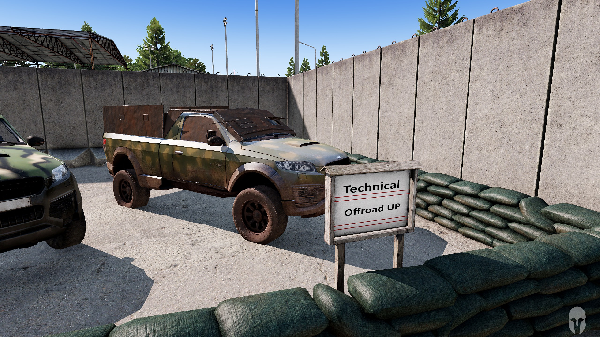{ width="600" }
/// caption
Technical - Offroad UP: Jeep met beplating. Lichte dreiging. Vijanden kunnen er makkelijk uitgeschoten worden. Geen AT nodig.
///

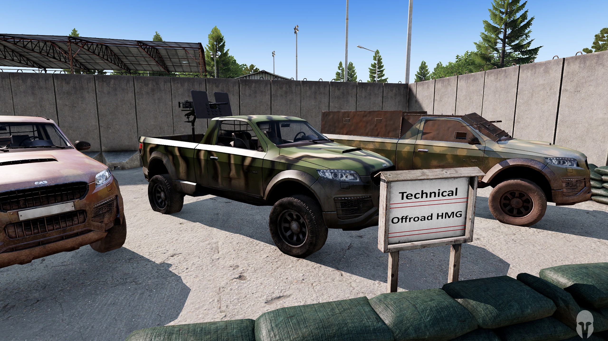{ width="600" }
/// caption
Technical - Offroad HMG: Jeep met .50 gun. Medium dreiging. Vijanden kunnen er makkelijk uitgeschoten worden. Vaak geen AT nodig.
///

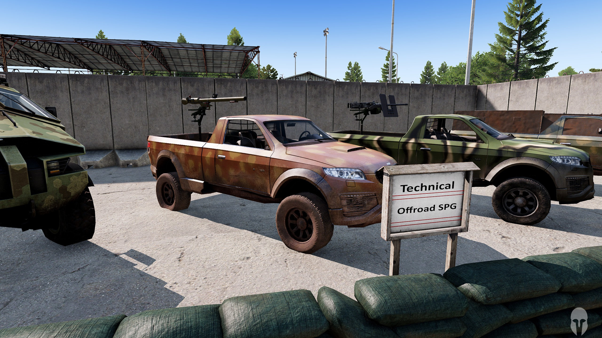{ width="600" }
/// caption
Technical - Offroad SPG: Jeep met SPG gun. Zware dreiging. Vijanden kunnen er makkelijk uitgeschoten worden. Vaak geen AT nodig.
///

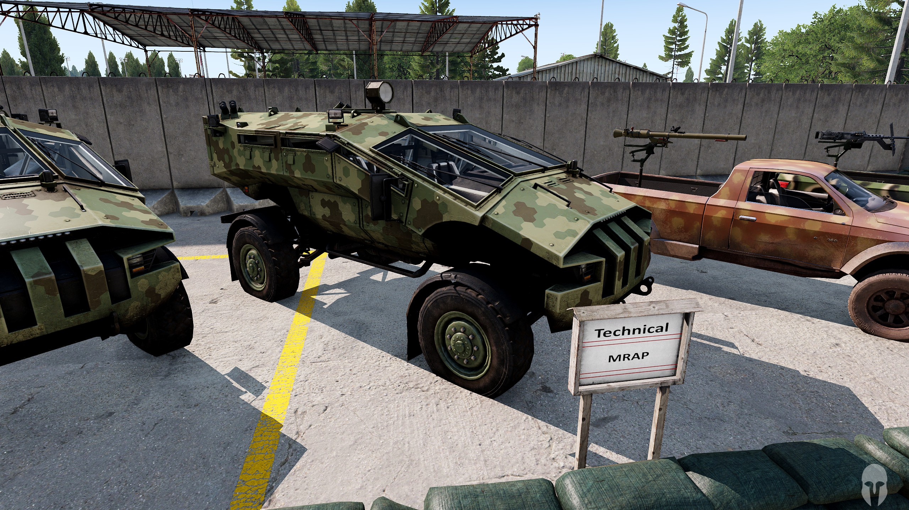{ width="600" }
/// caption
Technical - MRAP: Gepanserde auto. Lichte dreiging. Vijanden kunnen er moeilijk uitgeschoten worden. Geen AT nodig. Vervoert manschappen.
///

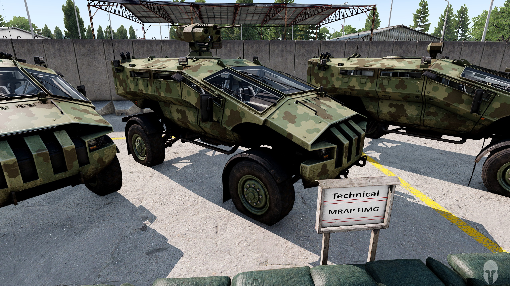{ width="600" }
/// caption
Technical - MRAP HMG: Gepanserde auto met .50 op het dak. Medium dreiging. Vijanden kunnen er moeilijk uitgeschoten worden. Wel AT nodig voor uitschakelen gunner!
///

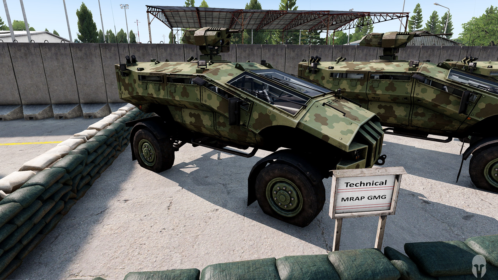{ width="600" }
/// caption
Technical - MRAP GMG: Gepanserde auto met grenade launcher op het dak. Zware dreiging. Vijanden kunnen er moeilijk uitgeschoten worden. Wel AT nodig voor uitschakelen gunner!
///

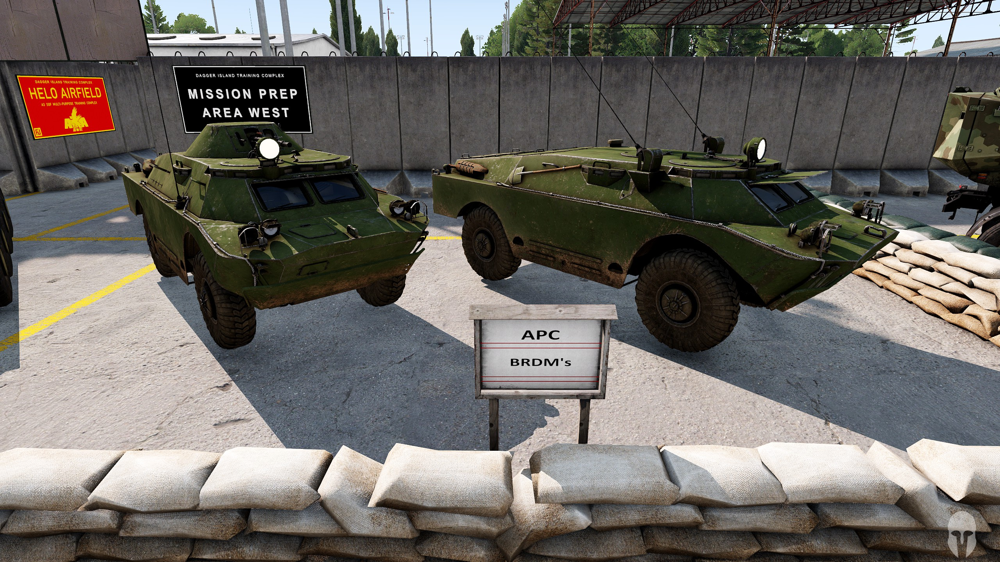{ width="600" }
/// caption
APC - BRDM's: Gepanserde wagens met of zonder gun. Met gun is zware dreiging. Vijanden kunnen er niet uitgeschoten worden. Wel AT nodig om uit te schakelen!
///

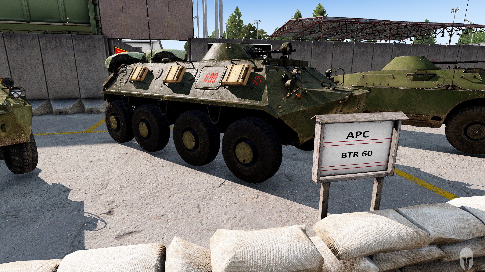{ width="600" }
/// caption
APC - BTR 60: Gepanserde wagen met gun. Hoe hoger het nummer, hoe zwaarder de guns. Zware dreiging. Vijanden kunnen er niet uitgeschoten worden. Wel AT nodig om uit te schakelen!
///

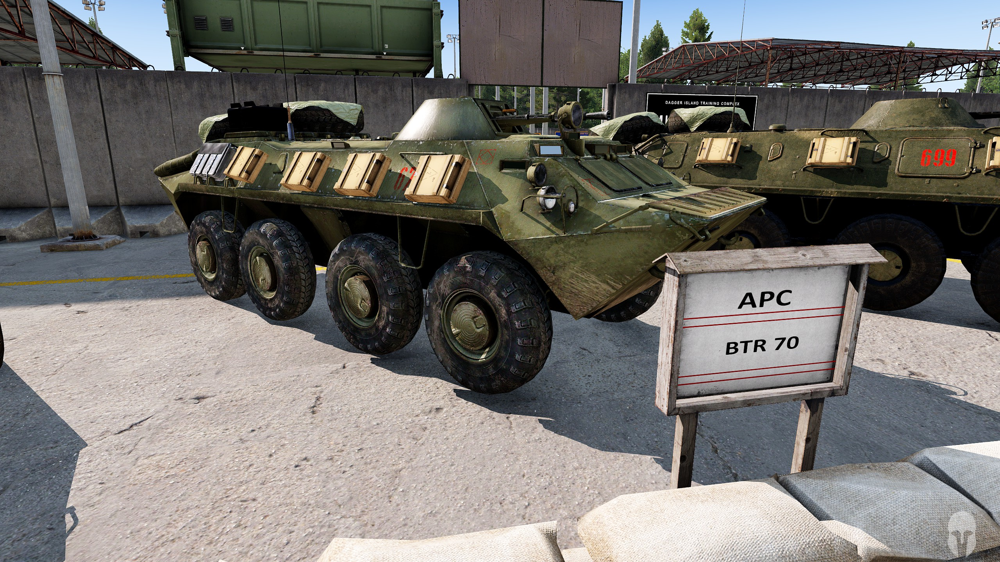{ width="600" }
/// caption
APC - BTR 70: Gepanserde wagen met gun. Hoe hoger het nummer, hoe zwaarder de guns. Zware dreiging. Vijanden kunnen er niet uitgeschoten worden. Wel AT nodig om uit te schakelen!
///

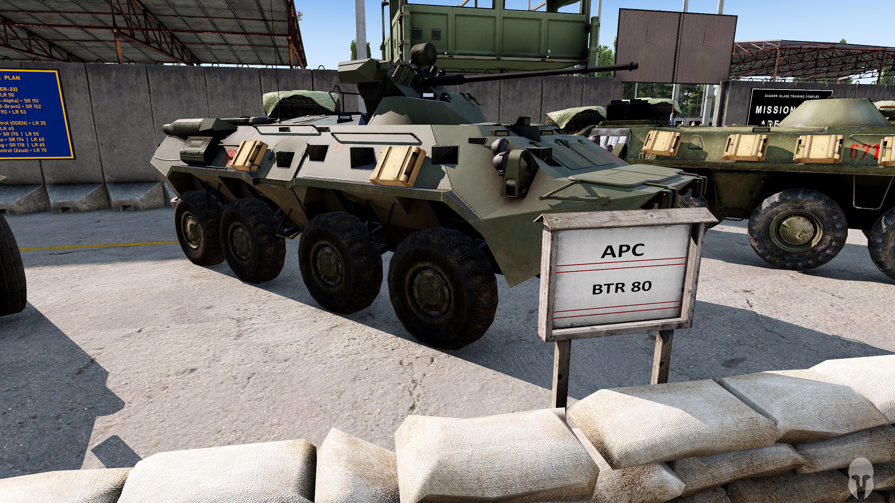{ width="600" }
/// caption
APC - BTR 80: Gepanserde wagen met gun. Hoe hoger het nummer, hoe zwaarder de guns. Zware dreiging. Vijanden kunnen er niet uitgeschoten worden. Wel AT nodig om uit te schakelen!
///

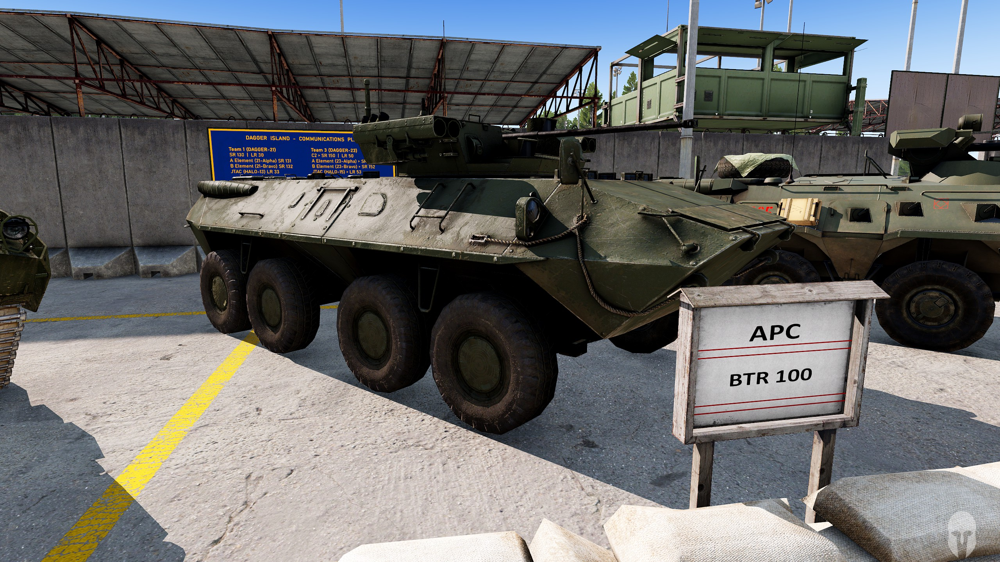{ width="600" }
/// caption
APC - BTR 70: Gepanserde wagen met gun. Hoe hoger het nummer, hoe zwaarder de guns. Zware dreiging. Vijanden kunnen er niet uitgeschoten worden. Wel AT nodig om uit te schakelen!
///

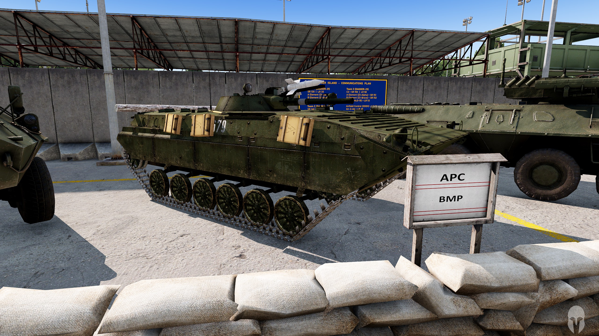{ width="600" }
/// caption
APC - BMP: Gepanserd rupsvoertuig met gun, lijkt op een tank maar is dat niet! Zware dreiging. Vijanden kunnen er niet uitgeschoten worden. Wel AT nodig om uit te schakelen!
///

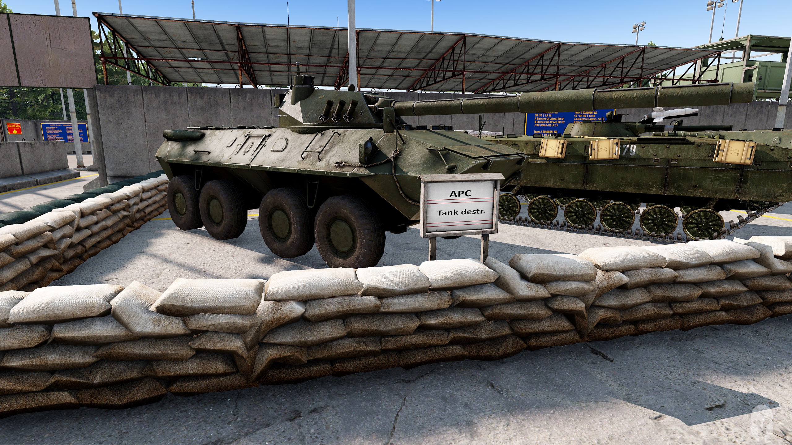{ width="600" }
/// caption
APC - Tank Destroyer: Gepanserde wagen grote gun. Zware dreiging. Vijanden kunnen er niet uitgeschoten worden. Wel AT nodig om uit te schakelen!
///

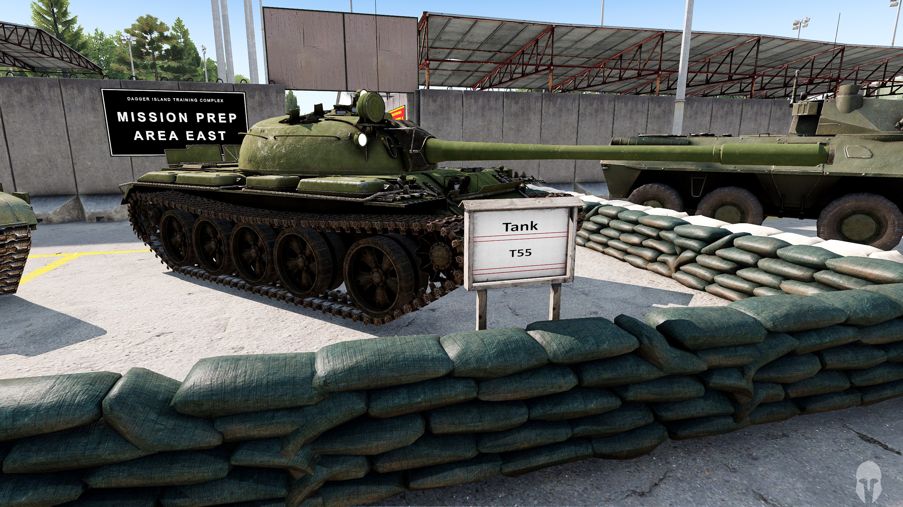{ width="600" }
/// caption
Tank - T55: Gepanserd rupsvoertuig met zware gun. Zware dreiging. Hoe hoger het nummer, hoe nieuwe de tank. Wel AT nodig om uit te schakelen!
///

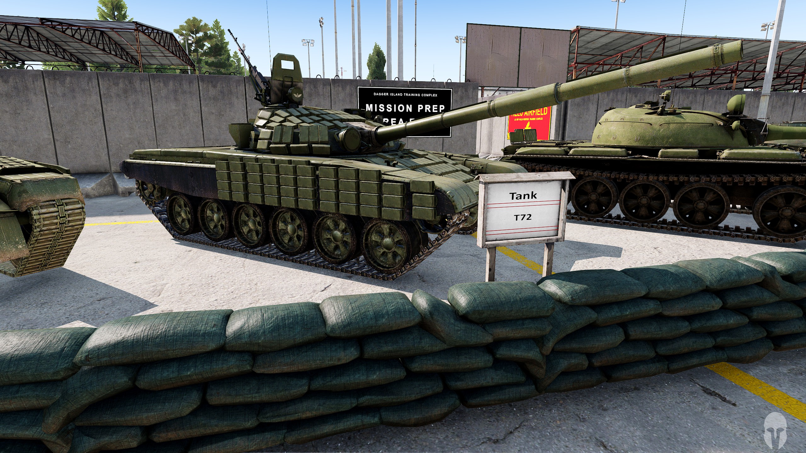{ width="600" }
/// caption
Tank - T72: Gepanserd rupsvoertuig met zware gun. Zware dreiging. Hoe hoger het nummer, hoe nieuwe de tank. Wel AT nodig om uit te schakelen!
///

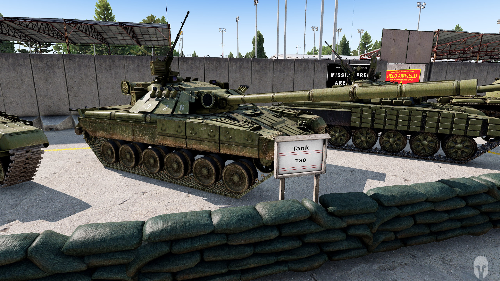{ width="600" }
/// caption
Tank - T80: Gepanserd rupsvoertuig met zware gun. Zware dreiging. Hoe hoger het nummer, hoe nieuwe de tank. Wel AT nodig om uit te schakelen!
///

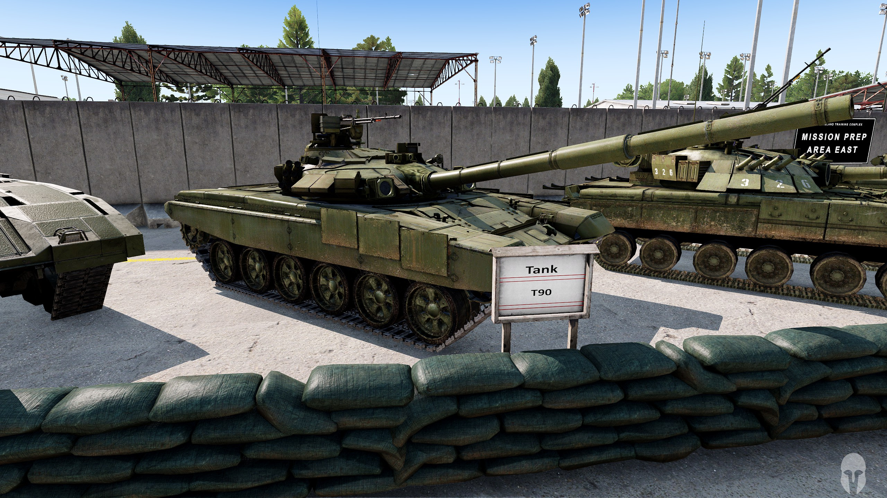{ width="600" }
/// caption
Tank - T90: Gepanserd rupsvoertuig met zware gun. Zware dreiging. Hoe hoger het nummer, hoe nieuwe de tank. Wel AT nodig om uit te schakelen!
///

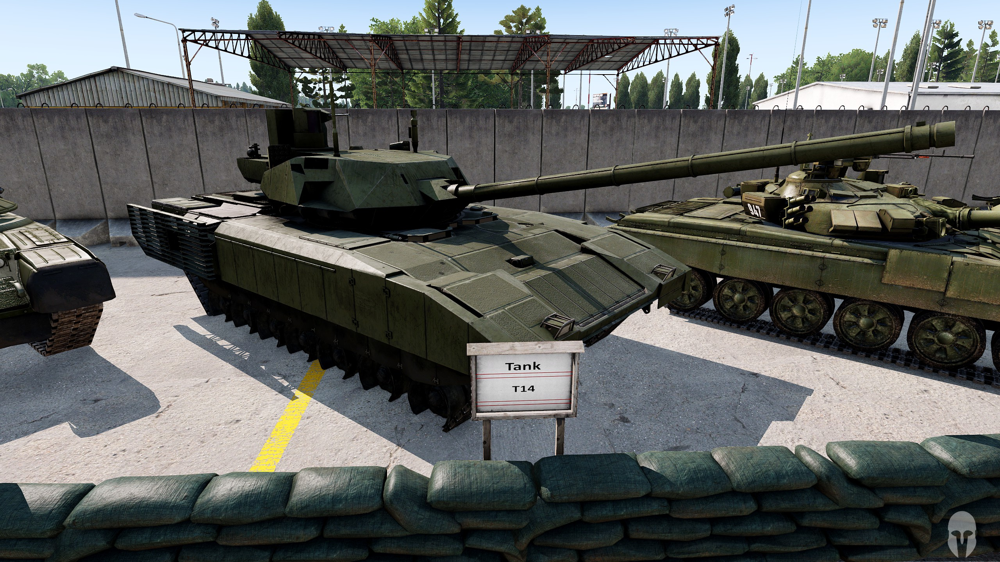{ width="600" }
/// caption
Tank - T14: Gepanserd rupsvoertuig met zware gun. Zware dreiging. Hoe hoger het nummer, hoe nieuwe de tank. Wel AT nodig om uit te schakelen!
///

{ width="600" }
/// caption
Tank - T00: Futuristisch gepanserd rupsvoertuig met zware gun. Zware dreiging. Hoe hoger het nummer, hoe nieuwe de tank. Wel AT nodig om uit te schakelen!
///

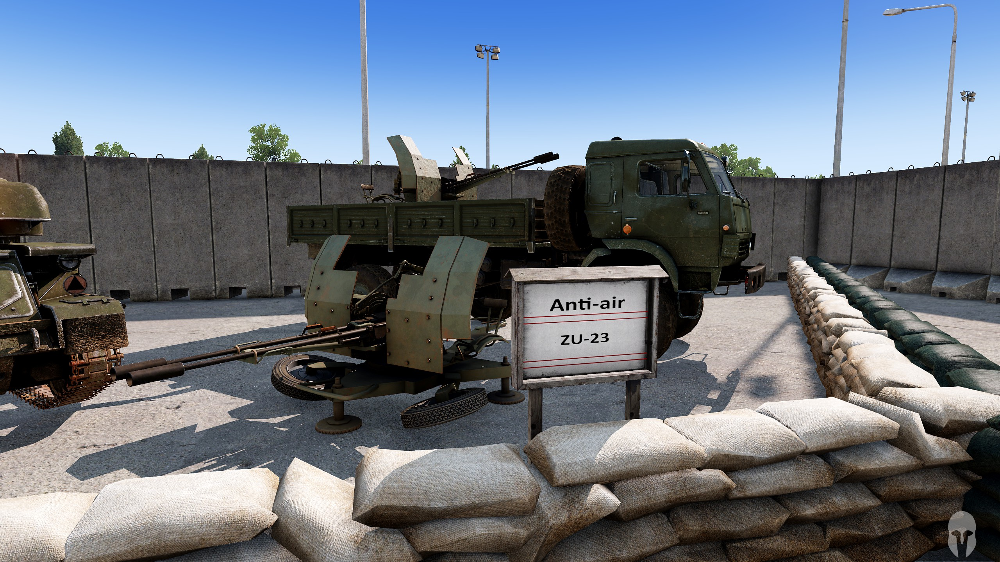{ width="600" }
/// caption
AA - ZU-23: Anti-air wapen. Kan statisch object zijn of gemonteerd zitten op een truck. Zware dreiging. Vijanden kunner er uitgeschoten worden. AT inzet op een truck kan ook.
///

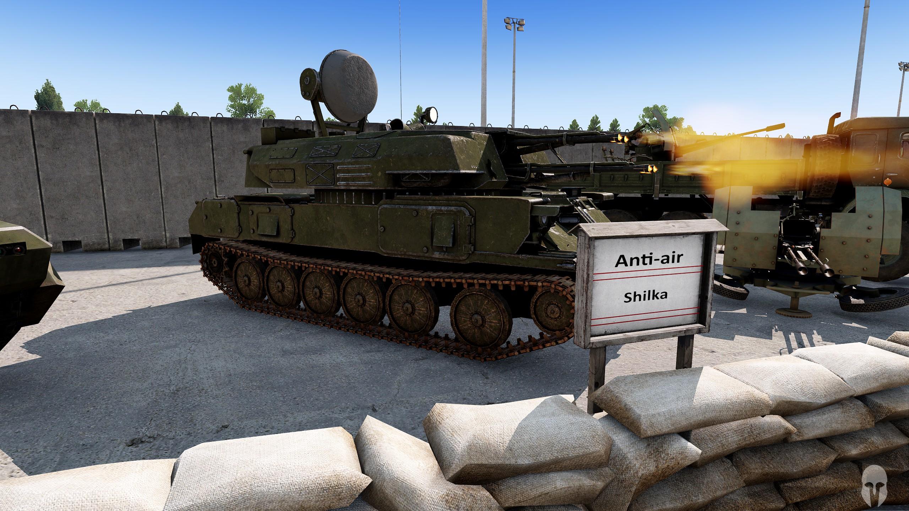{ width="600" }
/// caption
AA - Shilka: Gepanserde AA voertuig. Zeer hoge explosieve vuurkracht. Schiet ook op gronddoelen. Zware dreiging. Wel AT nodig om uit te schakelen!
///

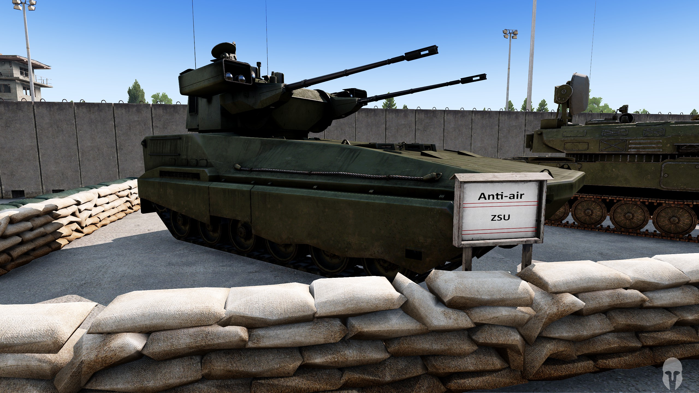{ width="600" }
/// caption
AA - ZSU: Gepanserde AA voertuig. Zeer hoge explosieve vuurkracht en rocket pods. Schiet ook op gronddoelen. Geavanceerde radar aanwezig. Zware dreiging. Wel AT nodig om uit te schakelen!
///

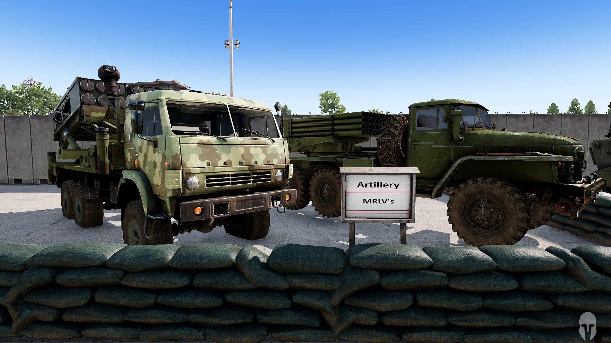{ width="600" }
/// caption
AA - MRLV's: Trucks met rakketwerpers. Medium dreiging op korte afstand. Zware dreiging op lange afstand. Wel AT nodig om uit te schakelen!
///

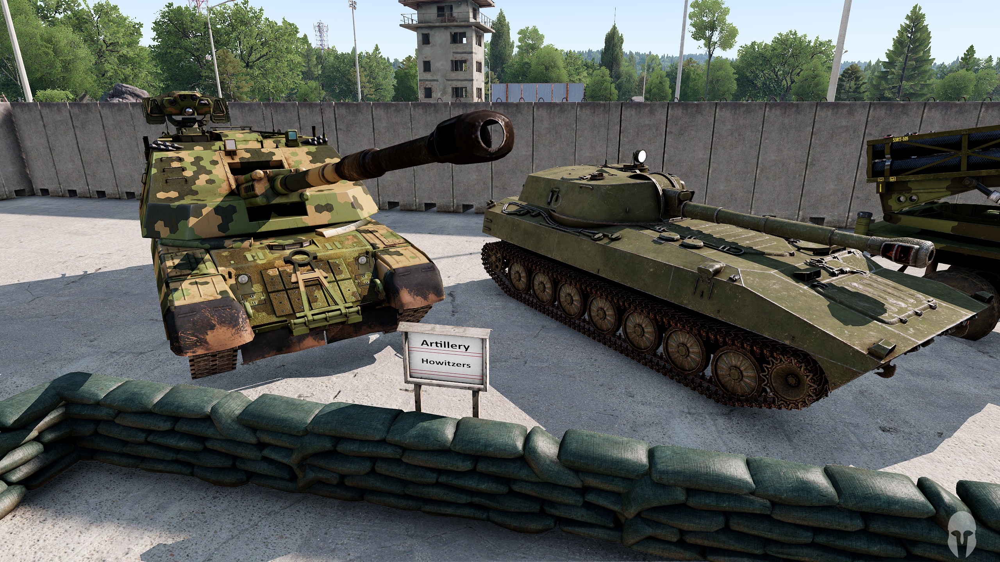{ width="600" }
/// caption
AA - Howitzers: Gepanserde wagen met 150mm gun. Medium dreiging op korte afstand. Zware dreiging op lange afstand. Nieuwe versie heeft ook een .50. Wel AT nodig om uit te schakelen!
///

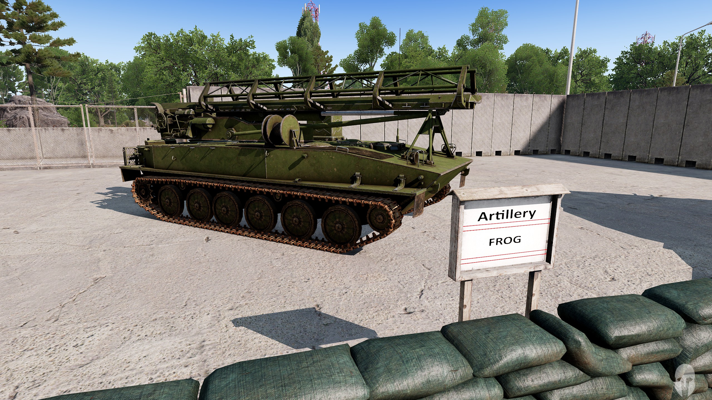{ width="600" }
/// caption
AA - FROG: Gepanserde rakketwerper. Lichte dreiging op korte afstand. Hele zware dreiging op lange afstand. Wel AT nodig om uit te schakelen!
///

{ width="600" }
/// caption
AA - Scarab: Gepanserde rakketwerper. Lichte dreiging op korte afstand. Hele zware dreiging op lange afstand. Wel AT nodig om uit te schakelen!
///

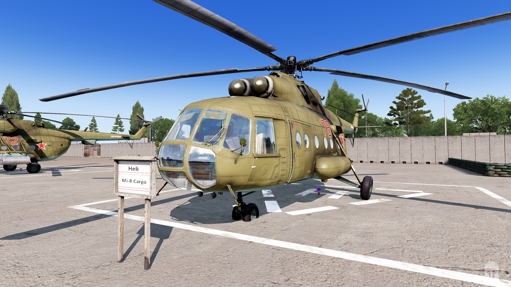{ width="600" }
/// caption
AA - Mi-8 Cargo: Cargo helikopter. Lichte dreiging. Vaak AA nodig om uit te schakelen!
///

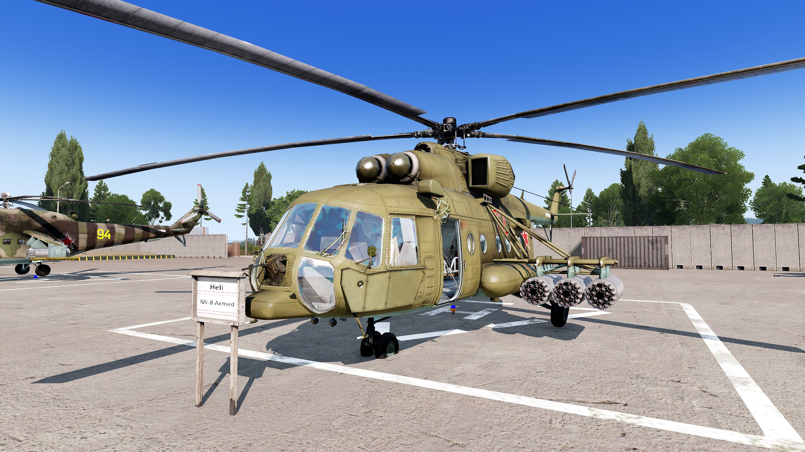{ width="600" }
/// caption
AA - Mi-8 Armed: Armed cargo helikopter. Heeft .50 door-gun en rocket pods. Zware dreiging. Vaak AA nodig om uit te schakelen!
///

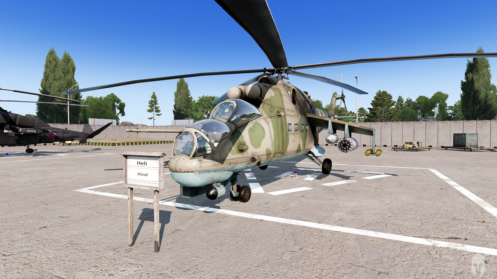{ width="600" }
/// caption
AA - Hind: Armed heli met rocket pods of zware wapensystemen. Zware dreiging. Vaak AA nodig om uit te schakelen!
///

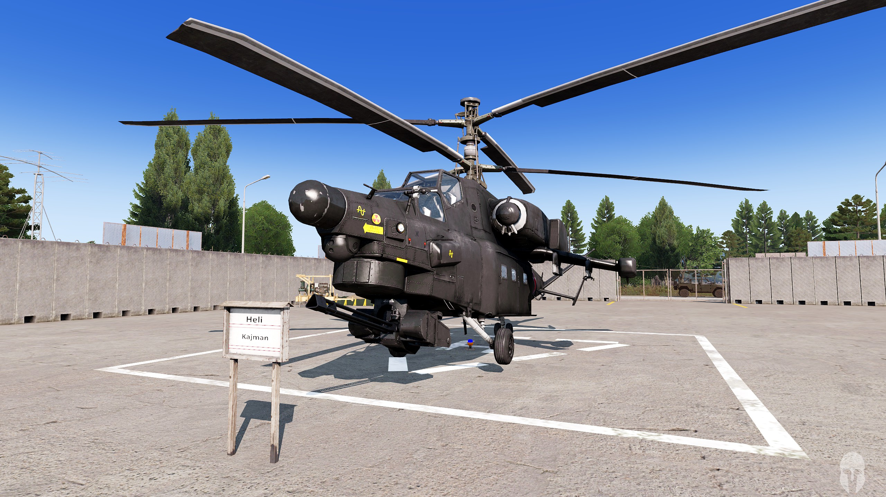{ width="600" }
/// caption
AA - Kajman: Geavanceerde armed heli met rocket pods en zware wapensystemen. Zware dreiging. Vaak AA nodig om uit te schakelen! Heeft countermeasures.
///