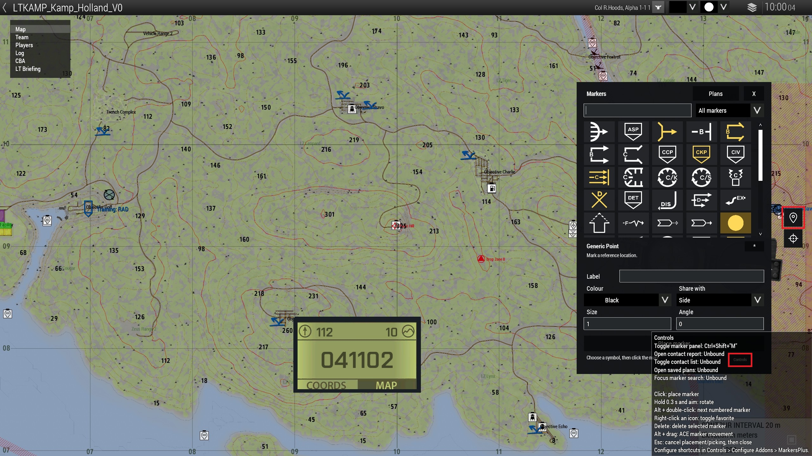
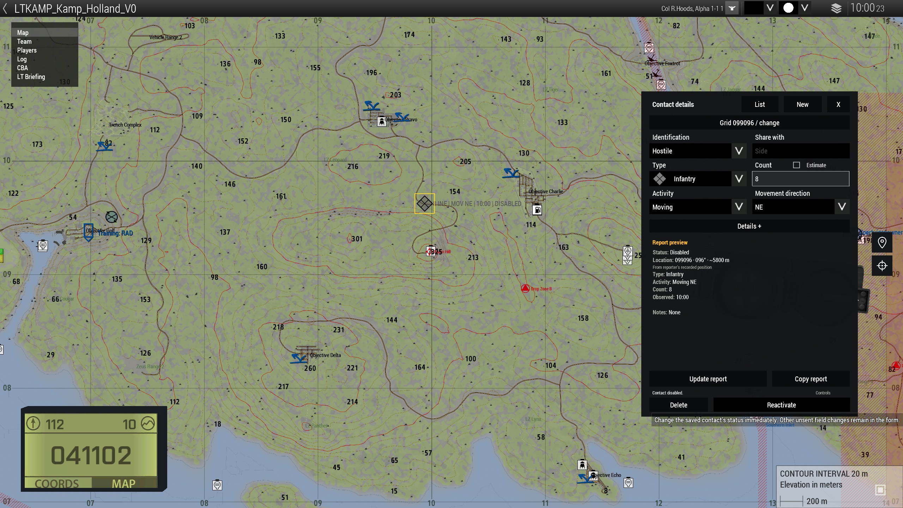
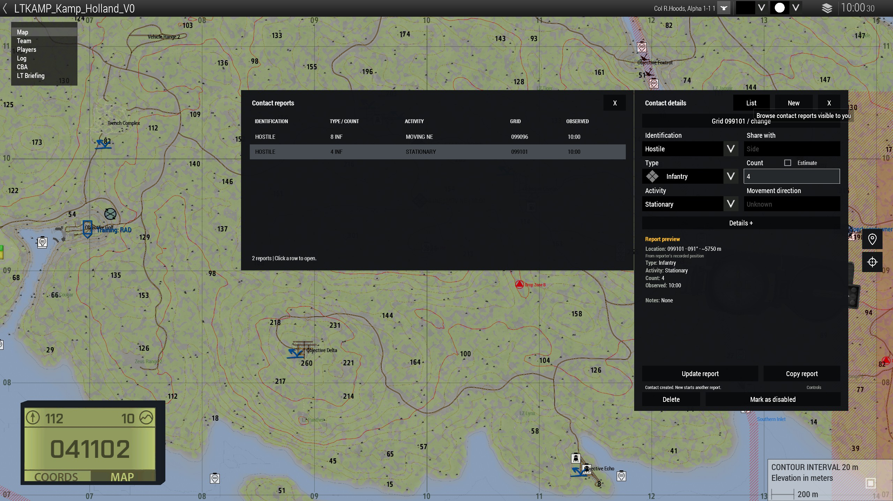
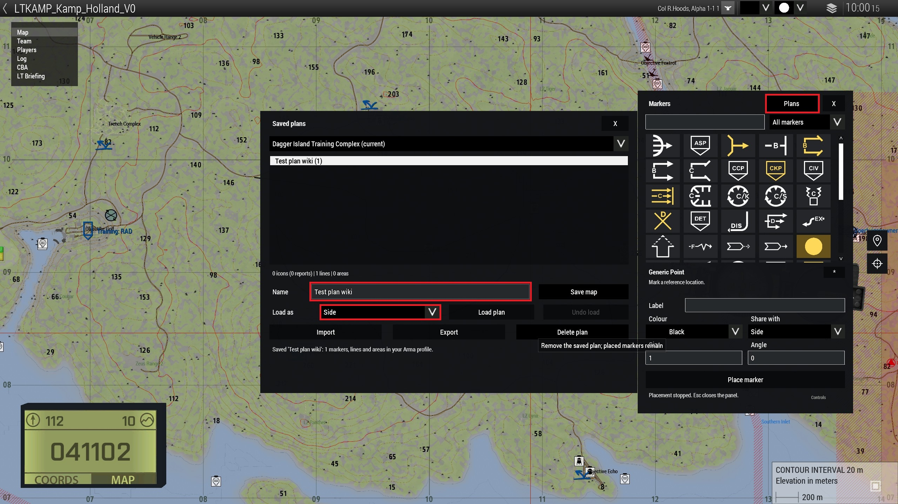

# 6.4. Markersplus

Markersplus is een breed inzetbaar hulpmiddel om zaken op de kaart te zetten. Dit kan door iedereen gebruikt worden voor het maken van contact reports. Voor de leidinggevende rollen is het extra fijn dat er een plantool in zit, waarmee je voor de sessie een volledig plan kunt opslaan. Dit plan kun je tijdens de missie inladen.
Dit scheelt aan het begin van de sessie veel tijd en er kan aanzienlijk sneller worden overgegaan tot het briefen. De spelers zijn hierdoor sneller in actie.

## Hoe het werkt
Markersplus zit standaard in de modset en is dus direct klaar voor gebruik. Je vind de tool aan de rechterkant op de map.

### Markers
Je opent Markersplus aan de rechterzijde op de kaart bij het navigatie-logo. In dit scherm vind je direct meerdere tools en functionaliteiten:

- Alle markers die je kunt plaatsen.
- Via RMB kun je gele favorieten aangeven.
- Rechts onderin vind je alle 'Controls' bij de bijbehorende knop.
- Onder de tabel vind je meerdere velden die je kunt invullen.
- Door een marker op de kaart te plaatsen en kort ingedrukt te houden, kun je de marker gelijk draaien op de juiste manier.

### Contact report
Je opent het Contact report scherm aan de rechterzijde op de kaar bij het doelwit-logo. In dit scherm vind je alle functionaliteiten om vijanden te markeren.

Hier kun je aangeven om wat voor vijand het gaat, hoeveel, waar ze eventueel naartoe bewegen, etc.

Wanneer je op 'Mark as disabled' drukt, wordt de marker grijs. Dit doe je als de vijand is uitgeschakeld. Door op 'Reactivate' te drukken wordt de marker weer actief.

Door op 'List' te drukken, zie je een overzicht verschijnen van alle actieve en inactieve markers. Als je in het linker scherm op een marker drukt, navigeer je hiernaar toe.

### Plans voorbereiden
Als PC kun je plannen voorbereiden met Markersplus. Dit doe je volgens onderstaand stappenplan:

1. Open de Arma 3 editor en ga naar de map die overeenkomt met de missie.
2. Plaats één unit.
3. Play de unit in multiplayer.
4. Teken heel jouw plan uit zoals je dat wenst.
5. Open Markersplus en selecteer 'Plans', bovenin.
6. Geef bij 'Name' een naam aan jouw plan. Selecteer 'Side' bij 'Load as' en druk op 'Save map'. Het plan staat nu opgeslagen.
7. Ga tijdens de sessie naar Markerplus en selecteer weer 'Plans', bovenin.
8. Selecteer de naam van jouw plan.
9. Selecteer 'Side' bij 'Load as'.
10. Druk op 'Load plan'. Jouw plan komt nu in de side-channel te staan en is voor iedereen zichtbaar.

Als je meer informatie wil over Markerplus, dan kun je de steam 'Usage Guide' lezen via deze link: [Steam Community :: Gids :: Markersplus Usage Guide](https://steamcommunity.com/sharedfiles/filedetails/?id=3365010538)